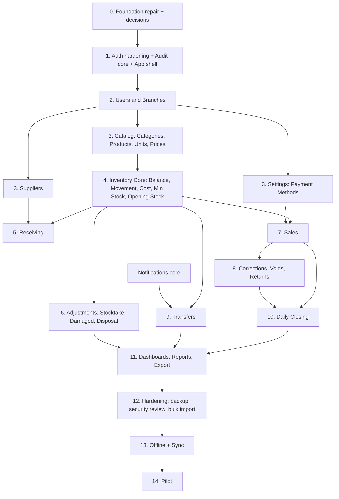

# Gelana — Phase 0 Implementation Audit

**Type:** Read-only repository inspection and requirements gap analysis
**Date:** 2026-10-06
**Commit inspected:** `ebc78be` (`main`) plus uncommitted working-copy change to `docs/project_decisions.md`
**Authoritative specification:** `docs/project_decisions.md` (working copy, 8,913 lines — Steps 1–6)

> [!NOTE]
> The request referred to `project_decision.md`. The actual file is
> `docs/project_decisions.md`. That file was used as the source of truth.
> No source code, schema, migration, dependency, or database was modified
> during this audit. The only file created is this document.

---

## 1. Executive Summary

The repository is an **early foundation**. It does not yet implement any
business module from the specification.

What exists and works:

- npm-workspaces monorepo (`apps/api`, `apps/web`, `packages/shared`).
- Express 5 + TypeScript API with a health endpoint, Helmet, CORS, Morgan,
  rate limiting, and centralized error handling.
- Login / logout / `me` using Argon2 password verification and a JWT stored
  in an HTTP-only cookie.
- Drizzle + PostgreSQL with 4 tables: `branches`, `users`, `categories`,
  `products` (2 migrations), plus a seed for 3 branches and 1 Owner.

What does **not** exist:

- No business endpoints at all (no users, branches, catalog, inventory,
  receiving, sales, returns, transfers, closing, reports, notifications,
  audit, settings).
- Authorization middleware exists but is **not mounted on any route** and
  contains defects.
- The frontend is the **unmodified Vite starter template**: no routing,
  login, layout, navigation, API client, or Gelana branding.
- No tests, no offline layer, no audit log, no inventory ledger.

Quality gates today:

| Check | Result |
| ----- | ------ |
| `npm run typecheck` (API) | **FAILS** — 2 errors in `authorize.ts` |
| Web typecheck | Passes, but web is **not in strict mode** and has no `typecheck` script |
| `npm run lint` (API) | **FAILS** — `oxlint` not installed for the API workspace |
| `npm run lint` (web) | Passes (template only) |
| Tests | None exist |

The two existing catalog tables (`categories`, `products`) **conflict with
the finalized product model** (nullable category, single unit, price stored
on product, no brand/description/image/units/price history).

Several **project documents conflict with the finalized specification**
(`src.md`, `project_plan.md`, `project_progress.md`, `database.md`). These
docs are read by agents before coding, so they will cause wrong
implementations unless reconciled first.

**Overall:** approximately 3–5% of Version 1 is implemented. The project is
well positioned to build correctly because almost nothing must be undone —
only the catalog schema and stale documentation need correction.

---

## 2. Current Architecture

### 2.1 Repository layout (tracked files: 65)

```text
/
├── AGENTS.md, README.md, package.json, tsconfig.base.json, .gitignore
├── apps/
│   ├── api/                      Express 5 + TypeScript (ESM, NodeNext)
│   │   ├── drizzle.config.ts
│   │   ├── .env.example          (.env exists locally, correctly untracked)
│   │   └── src/
│   │       ├── server.ts, app.ts
│   │       ├── config/database.ts            pg Pool + drizzle()
│   │       ├── database/schema/              branches, users, categories, products
│   │       ├── database/migrations/          0000_naive_blur, 0001_cool_nocturne
│   │       ├── database/seeds/index.ts       3 branches + 1 owner
│   │       ├── middleware/                   authenticate, authorize, errorHandler
│   │       ├── modules/auth/                 routes, controller, service, schema, jwt
│   │       ├── types/express.d.ts            req.user augmentation
│   │       └── utils/                        AppError, asyncHandler
│   └── web/                      Vite 8 + React 19 starter template
│       └── src/  main.tsx, App.tsx (Vite demo), App.css, index.css, assets/
├── packages/shared/              package.json only — empty
└── docs/                         instruction, plan, progress, decisions, src, database, api, ...
```

### 2.2 Stack versus approved stack

| Layer | Approved | Actual | Status |
| ----- | -------- | ------ | ------ |
| Frontend | React + TS + Vite | React 19, TS ~6.0, Vite 8 | IMPLEMENTED (template) |
| Routing | React Router | `react-router-dom` installed, unused | SCAFFOLDED |
| Server state | TanStack Query | installed, unused | SCAFFOLDED |
| Forms | React Hook Form + Zod | installed, unused | SCAFFOLDED |
| Client state | Zustand (minimal) | installed, unused | SCAFFOLDED |
| Backend | Node + Express + TS | Express 5, TS ^7.0 | IMPLEMENTED |
| Validation | Zod | Zod 4, used only in login | PARTIAL |
| DB | PostgreSQL + Drizzle + pg | Drizzle 0.45, pg 8 | IMPLEMENTED |
| Lint | Oxlint | Web only; API script broken | PARTIAL |
| Offline | IndexedDB/Dexie later | none | Correctly deferred |

No unnecessary or unapproved architecture was found. No POS, SQLite,
service worker, or extra framework exists.

### 2.3 Layering versus `instruction.md`

`instruction.md` requires `route → controller → service → repository`.

- The auth module has route/controller/service but **no repository layer**;
  the service queries Drizzle directly. Acceptable for one query, but the
  convention is not yet established.
- No `validate` middleware exists; the login controller validates inline.
- No `config/env.ts` environment validation (only ad-hoc `throw` checks).
- `packages/shared` is empty; no shared roles, statuses, or Zod contracts.

### 2.4 Observations about tooling

- `apps/api` uses TypeScript `^7.0.2`; `apps/web` uses `~6.0.2`.
  Two compiler majors in one monorepo is a maintenance risk.
- `apps/web/tsconfig.app.json` does **not** extend `tsconfig.base.json` and
  has **no `strict: true`**. This violates "Keep TypeScript strict".
- Root `npm run typecheck` silently skips the web app (no script).
- `@types/helmet` is a deprecated stub (Helmet ships its own types).

---

## 3. Requirements Coverage

Priority: **P0** = blocks correctness or security; **P1** = core V1;
**P2** = needed for V1 completeness; **P3** = later phase.

| Area | Status | Current State | Gap | Priority |
| ---- | ------ | ------------- | --- | -------- |
| Monorepo / tooling | PARTIALLY IMPLEMENTED | Workspaces, scripts, strict API TS | API typecheck + lint fail; web not strict; no tests | P0 |
| Login / logout | IMPLEMENTED | Argon2 verify, inactive users rejected, HTTP-only cookie, rate-limited | Error shape inconsistent; reveals "User is inactive" | P1 |
| Session handling | PARTIALLY IMPLEMENTED | 24h JWT in cookie | Role/branch/active status never re-checked; no revocation | P0 |
| Role authorization | SCAFFOLDED | `authorizeRole` exists | Not used anywhere; untyped roles | P0 |
| Branch authorization | SCAFFOLDED | `authorizeBranchAccess` exists | Not used; has defects (see §7) | P0 |
| Users / employees mgmt | MISSING | `users` table + seeded Owner | No CRUD, reset password, change password, deactivate | P1 |
| Branch assignment history | MISSING | `users.branch_id` only | No history entity | P1 |
| Branch management | PARTIALLY IMPLEMENTED (schema only) | `branches` table | No address/phone; no endpoints | P1 |
| Categories | SCAFFOLDED | Table + migration | No endpoints; no UI | P1 |
| Products | CONFLICTING | Table + migration | Nullable category; price on product; single unit; no brand/description/image | P0 |
| SKU generation | MISSING | Unique `sku` column | No generator | P1 |
| Product units / conversions | MISSING | single `unit` varchar | No base/alternate units, no versioning | P1 |
| Price history | CONFLICTING | `default_selling_price` on product | Spec §3.42 explicitly rejects this pattern | P0 |
| Minimum stock (per branch) | MISSING | — | Not modeled | P1 |
| Payment methods (configurable) | MISSING | — | No entity, no settings | P1 |
| Suppliers | MISSING | — | — | P1 |
| Receiving | MISSING | — | — | P1 |
| Opening stock (+ bulk) | MISSING | — | — | P1 |
| Inventory balance | MISSING | — | — | P0 |
| Inventory movement ledger | MISSING | — | — | P0 |
| Inventory cost records / WAC | MISSING | — | Technical design required | P0 |
| Stock adjustments | MISSING | — | — | P1 |
| Stocktake | MISSING | — | — | P2 |
| Damaged stock / disposal | MISSING | — | — | P2 |
| Sales / items / payments | MISSING | — | — | P1 |
| Sale correction / void | MISSING | — | — | P1 |
| Sales returns | MISSING | — | — | P1 |
| Transfers | MISSING | — | — | P1 |
| Transfer discrepancy | MISSING | — | — | P1 |
| Daily closing | MISSING | — | — | P1 |
| Dashboards (owner / employee) | MISSING | — | — | P2 |
| Sales / inventory / profit / closing reports | MISSING | — | — | P2 |
| Report export | MISSING | — | Format undecided | P2 |
| Notifications | MISSING | — | — | P2 |
| Audit log | MISSING | — | Needed by nearly every mutation | P0 |
| Human-readable transaction numbers | MISSING | — | Technical design required | P1 |
| Bulk product import | MISSING | — | — | P2 |
| Settings (general, payment methods, account) | MISSING | — | — | P1 |
| Backup & recovery | MISSING | — | Technical design required | P2 |
| Offline & synchronization | MISSING | — | Correctly deferred | P3 |
| Frontend shell / routing / login | MISSING | Vite demo page | Everything | P1 |
| Gelana UI / Stitch alignment | MISSING | Vite purple theme, title "web" | Everything | P1 |
| Automated tests | MISSING | — | No test runner configured | P0 |
| Documentation accuracy | CONFLICTING | Several docs contradict spec | See §8 | P0 |

---

## 4. Database Gap Analysis

### 4.1 Existing tables

| Table | Columns | Constraints | Notes |
| ----- | ------- | ----------- | ----- |
| `branches` | id (uuid), name, code, is_active, created_at, updated_at | PK, `code` UNIQUE | Missing address/location, phone |
| `users` | id, name, email, password_hash, role, branch_id, is_active, timestamps | PK, `email` UNIQUE, FK → branches | `role` has **no DB CHECK** (Drizzle `enum` is TypeScript-only) |
| `categories` | id, name, is_active, timestamps | PK, `name` UNIQUE (case-sensitive) | Basically aligned |
| `products` | id, sku, name, category_id, unit, default_selling_price, is_active, timestamps | PK, `sku` UNIQUE, FK → categories | Conflicts with spec (below) |

Seed data: branches named `BRANCH-1/2/3` with codes `123456/7/8`
(placeholders, not "Main Branch"), and an Owner with a **hard-coded password
`123456`** and a real-looking email committed in source.

### 4.2 Schema conflicts with the specification

| # | Conflict | Spec reference |
| - | -------- | -------------- |
| 1 | `products.category_id` is **nullable**; spec requires every product to have a category | Q57, BR-017 |
| 2 | `products.default_selling_price` stores price on the product; spec requires a separate Product Price entity with effective dates, per unit | Q51, BR-032–037, §3.9, §3.42 |
| 3 | `products.unit` is a single free-text value; spec requires base unit + optional alternate unit with fixed, versioned conversion | Q59, BR-026–033, §3.8 |
| 4 | No `brand`, `description`, `image` on products | Q58, BR-023–025 |
| 5 | `users.role` accepts any string at DB level | BR-010 |
| 6 | No rule that an `EMPLOYEE` must have a `branch_id` | BR-013, §3.4 |
| 7 | `branches` lacks address/location and phone | Branches, §3.3 |

### 4.3 Missing entities (from spec §3.44)

Of the 32 approved entities, only **Branch, User, Category** exist in an
acceptable form; **Product** exists but conflicts. Missing:

- **Master data:** Branch Assignment, Product Unit, Product Price, Supplier,
  Payment Method
- **Inventory:** Inventory Balance (available + damaged), Inventory
  Movement, Inventory Cost Record, Stock Adjustment, Stocktake, Stocktake
  Item, Stock Disposal, per-branch minimum stock
- **Receiving:** Receiving, Receiving Item
- **Sales:** Sale, Sale Item, Sale Payment, Sale Correction/Void
- **Returns:** Sales Return, Sales Return Item
- **Transfers:** Stock Transfer, Transfer Item, Transfer Discrepancy
- **Closing:** Daily Closing, Daily Closing Payment Summary
- **System:** Notification, Audit Log, Sync Operation

> [!IMPORTANT]
> The spec also requires an **inventory discrepancy for Owner review** when
> offline synchronization creates an inconsistency (Offline Stock Conflict
> Principle, BR-218). No such entity appears in the §3.44 entity list
> (only Transfer Discrepancy). This is a gap in the specification's own
> entity model and needs a decision before the sync phase.

### 4.4 Missing constraints

- `CHECK` for role values, status values, movement types, return
  condition (`SELLABLE`/`DAMAGED`).
- `CHECK` that employee rows have a branch.
- Non-negative available and damaged quantity on inventory balances
  (BR-063, BR-075) as a database safety net.
- Unique `(branch_id, product_id)` on inventory balance.
- Unique `(branch_id, business_date)` on daily closing.
- Exactly one base unit per product; base unit conversion = 1 (BR-029).
- Unique human-readable transaction numbers per type (BR-227/228).
- Unique idempotency/operation keys (BR-214, BR-244).
- Positive quantities on receiving, sale, return, transfer, disposal lines.
- No `ON DELETE` policy is defined; protected records need
  `RESTRICT`-style protection against deletion (BR-229/230).
- `updated_at` is never maintained automatically.

### 4.5 Missing indexes

None exist beyond PK/unique. `database.md` already lists the right
query-driven targets (sales by branch/date, movements by
product/branch/time, transfers by status, closings by branch/date, audit by
actor/time). Add them with the tables that need them.

---

## 5. Backend Gap Analysis

### 5.1 Existing

| Item | Status | Notes |
| ---- | ------ | ----- |
| `GET /api/v1/health` | Works | — |
| `POST /api/v1/auth/login` | Works | Zod-validated, rate-limited (10 / 15 min) |
| `POST /api/v1/auth/logout` | Works | Clears cookie only |
| `GET /api/v1/auth/me` | Works | Returns **JWT payload**, not the current DB user |
| `authenticate` middleware | Works | Verifies JWT only |
| `authorizeRole` | Unused | Accepts `string[]` instead of `UserRole[]` |
| `authorizeBranchAccess` | Unused, defective | See §7 |
| `errorHandler` | Works | Shape `{ error: string }` ≠ `api.md` shape `{ error: { code, message, details } }` |
| `asyncHandler` | Works | Uses `Promise<any>` (violates "avoid `any`") |
| Helmet / CORS / Morgan / rate limit | Present | CORS allows only `https://localhost:5173`, but Vite serves `http://` by default |

### 5.2 Missing modules (per spec §4.19)

Every business module is missing: users, branches, categories, products
(units, prices), suppliers, payment methods, receiving, inventory (stock,
movements, opening stock, adjustments, stocktakes, damaged, disposal,
valuation), sales, returns, corrections, transfers, closing, reports,
dashboard, notifications, audit, settings, import/export, sync.

### 5.3 Missing cross-cutting backend capabilities

- **Request validation middleware** (body/params/query) and shared schemas.
- **Consistent error contract** and business-rule error messages
  ("what / why / what next" — BR-260).
- **Database transactions** — `db.transaction` is not used anywhere yet.
- **Central inventory service** that every stock change must go through.
- **Audit writer** that records in the same transaction as the change.
- **Transaction number generator.**
- **Idempotency handling** for create requests (BR-244 covers double-click
  and API retries, not only offline sync).
- **Business-date resolution** in the business's local timezone (BR-245).
- **Env validation** module.
- **Repository layer** convention.

### 5.4 Authorization logic still required

- Role checks on every Owner-only route (list in spec §6.6–6.24).
- Branch scoping derived from the **authenticated user**, not from
  client-supplied `branchId`, for employees.
- Action-level checks that depend on workflow state (§6.32).
- Field-level redaction of cost/profit data for employees (§6.28).

---

## 6. Frontend Gap Analysis

### 6.1 Existing screens

None. `App.tsx` is the Vite starter (counter, Vite/React logos, links to
Vite docs/Discord/X). Page title is `web`. Styles use the Vite purple
accent (`#aa3bff`) and automatic light/dark scheme.

### 6.2 Missing screens (spec §5.18 — 49 capabilities)

All 49 are missing: Login; Owner/Employee Dashboards; Sales History, New
Sale, Sale Details, Returns, New Return, Return Details; Current Stock,
Stock Movement, Receiving (list/new/detail), Adjustments (list/new/detail),
Stocktakes (list/new/detail), Damaged Stock, Disposal, Valuation; Transfers
(list/new/detail); Products, New/Edit Product, Product Details,
Categories; Suppliers (list/detail/edit); Closing (current/history/detail);
Sales/Inventory/Profit/Closing Reports; Employees (list/detail/edit),
Branches (list/detail); Notifications; General Settings, Payment Methods,
Account & Security.

### 6.3 Missing infrastructure

- Router configuration and protected routes.
- Role-based navigation (Owner vs Employee sets, §6.3/6.4).
- App shell: business identity, user name/role, employee branch, Owner
  branch context, notifications, sync status placeholder, logout (§6.5).
- QueryClient provider, API client (`credentials: "include"`), dev proxy or
  CORS alignment.
- Feature folder structure (`features/*`) per `instruction.md`.
- Reusable UI: tables, forms, drawers, dialogs, status badges, empty /
  loading / error states.
- Design tokens (Gelana blue `#0047FF`, warm white `#FFF8E7`).

### 6.4 Stitch reference comparison

The Stitch designs are **not present in the repository**, and no UI based
on them has been built. A visual comparison is therefore **not possible**.
Nothing in the current UI introduces rejected features (POS, cash drawer,
barcode, customers, loyalty, credit sales, etc.) because there is no UI.

> [!NOTE]
> The brand colors `#0047FF` / `#FFF8E7` and the closing status labels
> ("Not Submitted", "Submitted — Awaiting Approval", "Approved",
> "Rejected — Correction Required") come from the audit request, **not**
> from `project_decisions.md`. They should be recorded in the decisions
> document (Step 7 outcome) so future agents treat them as approved.

### 6.5 Terminology risk

`src.md` uses "POS/search/cart" and "POS cart" (§8.1, §16, §17.2). The
specification states that Gelana is **not** a POS and does not replace the
receipt/cash process. Use "New Sale" / "sale entry" terminology instead.

---

## 7. Security & Authorization Gaps

> [!IMPORTANT]
> Today, an employee **cannot** perform an owner-only business action
> because **no business endpoints exist**. The risks below are latent and
> will become real the moment business routes are added on top of the
> current middleware.

### 7.1 Defects in existing authorization code

| # | Location | Issue | Impact |
| - | -------- | ----- | ------ |
| 1 | `authorize.ts` `authorizeBranchAccess` | Missing `return` after `next(new AppError(...))` when `req.user` is absent; execution continues to `req.user.role` | Crash / double `next()`; also the cause of the failing typecheck |
| 2 | same | Reads `req.body.branchId`; in Express 5 `req.body` is `undefined` for requests without a JSON body (e.g. GET) | `TypeError` → 500 on GET routes using it |
| 3 | same | Picks the **first** of `params`, `body`, `query`; a handler that uses a different source can be bypassed (e.g. URL param = own branch, body = other branch) | **Cross-branch access bypass** risk |
| 4 | same | Branch ID supplied by the client instead of derived from the session for employees | Same bypass class; violates §6.26 |
| 5 | same | Missing branch ID returns **401** (should be 400/403) | Incorrect semantics |
| 6 | `authorizeRole` | Not applied to any route; role typed as `string` | No enforcement exists yet |

### 7.2 Session weaknesses

| # | Issue | Impact |
| - | ----- | ------ |
| 1 | `authenticate` trusts the JWT payload for role, branch, and active status for 24 h | A **deactivated employee keeps access** up to 24 h (violates BR-015); a branch reassignment is not reflected (violates BR-013/BR-241) |
| 2 | No token revocation on logout, password reset, or deactivation | Stolen/old tokens remain valid |
| 3 | JWT algorithm not pinned on verify | Hardening gap |
| 4 | `.env.example` contains a guessable default `JWT_SECRET` | Risk if copied to production |
| 5 | Seed Owner password `123456` hard-coded in source | Must not reach any shared/production DB |
| 6 | Login returns "User is inactive" for valid-but-inactive accounts | Account enumeration |
| 7 | CORS rejection surfaces as 500 "Internal server error" | Misleading errors |
| 8 | Rate limiter is in-memory | Acceptable for single instance; note for deployment |

### 7.3 Missing protections required by the spec

- Backend enforcement of all Owner-only actions (§6.10–6.24).
- Employee data isolation by branch and by own-sales (§6.7, §6.26).
- Owner-only fields (purchase cost, WAC, valuation, profit) must be removed
  from employee API responses, not hidden in React (§6.28).
- Offline sync must not elevate permissions (§6.34–6.35) — future.

---

## 8. Business Rule Conflicts

These are **high priority**. Code conflicts are listed first, then
documentation conflicts (docs are agent instructions, so they act like code).

### 8.1 Code conflicts

| # | File | Conflict | Spec |
| - | ---- | -------- | ---- |
| C1 | `schema/products.ts` | Category optional | Q57, BR-017 |
| C2 | `schema/products.ts` | Current price stored on product, no history | Q51, BR-036/037, §3.42 |
| C3 | `schema/products.ts` | Single `unit`, no alternate unit/conversion | Q59, BR-026–033 |
| C4 | `schema/products.ts` | No brand/description/image | Q58 |
| C5 | `schema/branches.ts` | No address/phone | Branches |
| C6 | `middleware/authenticate.ts` | Inactive users keep working until token expiry | BR-015 |
| C7 | `seeds/index.ts` | Placeholder branch names/codes instead of real branches | Context §1 (minor, data) |

### 8.2 Documentation conflicts

| # | Document | Conflicting content | Spec position |
| - | -------- | ------------------- | ------------- |
| D1 | `src.md` §3.3, §7.2, §13, §17; `project_plan.md` §3, §6; `project_progress.md` Ph.4, Ph.6; `database.md` | **Receipt-number capture and receipt-sequence reconciliation** at closing | Not approved. Gelana sale number is separate from the physical receipt (Q17, BR-091) and the receipt process stays outside Gelana (Q7, BR-092) |
| D2 | `src.md` §3.2, §13; `project_plan.md` §6 | Closing states `OPEN → LOCAL_CLOSED → SYNC_PENDING → CENTRALLY_CONFIRMED`; closing allowed offline | Closing is **blocked** until required data syncs (Q35, BR-165, BR-216) and requires Owner approval (Q36, BR-157) |
| D3 | `src.md` §13 | Discrepancy reason "optional/required according to threshold" | Any cash discrepancy requires a reason (Q33, BR-162) |
| D4 | `src.md` §3.6; previous ADR | Transfer lifecycle `REQUESTED → APPROVED → IN_TRANSIT → RECEIVED`; no COMPLETED, cancellation, partial approval, multi-source | `REQUESTED → APPROVED → DISPATCHED → RECEIVED → COMPLETED` / `REJECTED`; cancel before dispatch; partial; multi-source (Q22–29) |
| D5 | `src.md` §14, §2; `project_progress.md` Ph.7 | "Average transaction value" and "slow movers / slow-moving products" | Not in approved reports (BR-173–176, §4.10) — unapproved analytics |
| D6 | `src.md` §10.3 | Movement types `DAMAGE`, `COUNT_CORRECTION`, `ADJUSTMENT_INCREASE/DECREASE`; missing `OPENING_STOCK`, `RETURN`, `DISPOSAL` | BR-238, §3.14 |
| D7 | `src.md` §9.2 | `branch_inventory.quantity` only; `products.default_selling_price`; `products.unit` | Available + damaged quantities (§3.13); price history (§3.9); units (§3.8) |
| D8 | `src.md` §11.6 | Automatic background sync; "do not make employees manually approve" | Prompt "Sync Now / Sync Later" (Synchronization, §4.15) |
| D9 | `src.md` §3.7 | Fixed payment-method list | Owner-configurable, not hard-coded (Q16, BR-104) |
| D10 | `src.md` §8.1, §16, §17.2 | "POS cart", "POS/search/cart" | System is not a POS (Context §1) |
| D11 | `project_progress.md` | Missing phases: suppliers, payment methods, opening stock, returns, stocktake, damaged/disposal, notifications, settings, bulk import, branch assignment history | All required in V1 (§4.19) |
| D12 | `project_progress.md` | "API hardening" marked Todo (it is implemented); categories/products schema marked Todo (they exist); "Verify typecheck/lint" marked Done (both now fail) | Progress must be factual |
| D13 | `api.md` | Error shape `{ error: { code, message, details } }` | Implementation returns `{ error: string }` |
| D14 | `docs/project_decisions.md` (uncommitted) | The previous ADR log (React+Express, TypeScript, Drizzle, monorepo, Oxlint, IndexedDB/Dexie, ledger, void-not-delete, email identity, nullable owner branch) was **replaced** by the new spec. The old header said "do not rewrite old decisions; append" | Technical ADRs are no longer recorded anywhere authoritative |

### 8.3 Internal inconsistencies inside `project_decisions.md`

These are not code conflicts, but they must be resolved before the related
module is built. They are listed here, not resolved.

| # | Topic | Statement A | Statement B |
| - | ----- | ----------- | ----------- |
| S1 | Discount authority | "Only Owner can apply/authorize discounts" (Discounts, BR-100) | Sales permissions table: "Apply permitted discount — Employee: Yes" (§6.7) |
| S2 | Minimum stock | Branch-specific thresholds (Minimum Stock, BR-068/070) | Product entity has a required "Minimum Stock Threshold" field (§3.7); New Product screen has one field (Screen 28) |
| S3 | Transfer sources | One request can use multiple source branches (Q27, BR-147) | Stock Transfer entity has a single "Source Branch" (§3.31) |
| S4 | Closing statuses | `OPEN, SUBMITTED, APPROVED, REJECTED, CORRECTION_REQUIRED, CORRECTED` (§3.34) | `Submitted, Approved, Rejected` (BR-258); four labels in the audit request |
| S5 | Closing per-method actuals | Payment summary has "Actual" per method (§3.35) | Only actual counted cash is entered (BR-158, BR-160) |
| S6 | Offline conflict discrepancy | Required (BR-218) | No entity in §3.44 |

---

## 9. Technical Decisions Still Required

Each item below is marked **TECHNICAL DECISION REQUIRED**. No solution is
chosen here.

| # | Decision | Why it matters |
| - | -------- | -------------- |
| T1 | **Inventory ledger implementation** — balance + movement tables, how before/after quantities are captured, row locking vs. constraints for concurrency | Two simultaneous sales at one branch must never oversell or produce wrong before/after values (BR-063, BR-239) |
| T2 | **Damaged stock representation** — column on balance vs. separate state; movement types for damaged in/out | Determines how returns, disposal, reports, and valuation work (BR-132–136) |
| T3 | **In-transit stock representation** — on transfer items, a virtual location, or a balance column | Required to show in-transit stock and to reconcile dispatch vs. receipt (BR-143) |
| T4 | **Weighted Average Cost calculation** — per branch or business-wide; effect of transfers, returns, opening cost, adjustments, disposal; rounding; zero-stock reset | Every profit and valuation number depends on it (BR-186–189) |
| T5 | **Sale-item cost snapshot** — when the cost is captured and with what precision | Historical profit must never change (BR-188/189) |
| T6 | **Return accounting & inventory behavior** — refund source (sale snapshot, discount allocation), cost re-entry for sellable vs. damaged, reversal of profit | Wrong design silently corrupts profit and stock value (Inventory Costing, BR-125/126) |
| T7 | **Sale correction/void model** — dedicated correction entity vs. reversal + re-entry; editable scope for employees before closing | Must preserve originals and produce correct inventory/financial effects (BR-113–118) |
| T8 | **Transfer stock-state implementation** — including multi-source modeling (S3) and RECEIVED vs. COMPLETED trigger | Determines movement creation and discrepancy handling (BR-142–154) |
| T9 | **Transaction ID generation** — `SAL-000123` style; global vs. per-branch sequences; gaps allowed; numbering for offline-created records | Must be unique and never reused (BR-227/228) and work offline later |
| T10 | **Database transaction boundaries & isolation** | Sale, receiving, return, transfer dispatch/receipt, adjustment, disposal, closing approval are multi-step (BR-243) |
| T11 | **Idempotency mechanism for online requests** | Double-click and network retry must not duplicate sales (BR-244) |
| T12 | **API validation strategy** — validate middleware, shared Zod contracts in `packages/shared`, single error shape | Consistent boundary validation and user-friendly errors (BR-259/260) |
| T13 | **Audit log structure** — generic before/after JSON vs. typed records; written in the same DB transaction | Permanent, non-deletable history for every important action (BR-203–206, BR-234) |
| T14 | **Money and quantity types** — numeric precision, integer vs. decimal base quantities, rounding rules | Payment equality checks (BR-108–110) and WAC math depend on it |
| T15 | **Business date & timezone** — which timezone; how delayed sales map to a business date | Closing association (BR-172, BR-245–247) |
| T16 | **Session strategy** — token lifetime, per-request user re-check, revocation on deactivate/reset | Inactive users must not operate (BR-015) |
| T17 | **Offline database technology** — previous ADR chose IndexedDB + Dexie, but that ADR was removed from the decisions file | Needs reconfirmation before Phase "Offline" |
| T18 | **Sync queue architecture & protocol** | Never lose offline sales; retries; status display (BR-212–216) |
| T19 | **Sync conflict handling** — including the missing inventory-discrepancy entity (S6) | Legitimate sales must be preserved (BR-217/218) |
| T20 | **Backup frequency, retention, storage, encryption, restore** | Explicitly deferred (BR-235–237) |
| T21 | **Product image storage** | Optional image field needs a storage approach (Q58) |
| T22 | **Import/export file formats** | Bulk import validation and report export (BR-222–226, Export) |
| T23 | **Notification generation** — inside the business transaction vs. after commit; de-duplication of repeated low-stock events | Avoid lost or spammed notifications (BR-197–202) |
| T24 | **Owner branch context** — how the Owner selects a branch for branch-specific actions (sales, closing, receiving) | Owner has no assigned branch (`branch_id` null) |

### 9.1 Business clarifications required (not technical)

These need an Owner/business answer; they are not invented here.

- **S1** Discount: who applies discounts and how employee-applied discounts
  are authorized.
- **S2** Minimum stock: one product-level value, per-branch values, or both.
- **S4** Final closing status set and labels.
- **S5** Whether non-cash payment methods have "actual" amounts at closing.
- **Unentered-sales check (BR-164):** how the system determines that paper
  sales remain unentered (receipt reconciliation is **not** approved).
- **Expected cash:** whether cash refunds from returns reduce expected cash,
  and which business day a return belongs to.
- **Employee pre-closing correction scope (BR-114):** which fields an
  employee may correct.
- **Receiving draft state (BR-049):** whether unconfirmed receivings are
  saved as drafts or only confirmed on submit.
- **Calendar:** confirm Gregorian dates for the "local calendar date".

---

## 10. Recommended Implementation Order

### 10.1 Dependency graph (derived from spec + repo)



Each phase should be delivered as a **vertical slice**: schema → migration →
repository → service → routes (with authorization) → tests → screens →
docs.

### 10.2 Phases

**Phase 0 — Foundation repair & decision recording**
- Contains: fix API typecheck; fix API lint script; make web strict and add
  a web `typecheck` script; align TS versions; establish test runner
  (needs dependency approval); validation middleware and single error shape;
  env validation; reconcile conflicting docs (§8.2); restore technical ADRs;
  record answers to T9–T16 and §9.1 items needed by Phases 1–4.
- Depends on: nothing.
- Exit criteria: typecheck, lint, build, and a first test all green; docs no
  longer contradict the spec.

**Phase 1 — Auth hardening, audit core, frontend shell**
- Contains: fix `authorizeBranchAccess` defects; derive employee branch from
  session; per-request active-user check (per T16); typed roles; audit log
  table + writer; frontend router, QueryClient, API client, Login screen,
  protected routes, role-based app shell with Gelana tokens.
- Depends on: Phase 0.
- Exit: an employee cannot reach any Owner-only route by API; deactivated
  users are rejected immediately; audit writes are transactional.

**Phase 2 — Users & Branches**
- Contains: branch fields (address, phone), branch CRUD + deactivation;
  employee create/edit/deactivate, reset password, change own password;
  branch assignment history; EMPLOYEE-requires-branch constraint; real seed
  data.
- Depends on: Phase 1.
- Exit: Screens 41–45 and 49 work; all actions audited.

**Phase 3 — Catalog, payment methods, suppliers**
- Contains: categories; product schema correction (C1–C4) via new
  migration; SKU generation; product units with versioned conversion;
  product price history per unit; search/filter (name, SKU, category,
  brand); payment methods settings; suppliers.
- Depends on: Phase 2.
- Exit: Screens 27–33, 47–48 work; price change never affects history.

**Phase 4 — Inventory core**
- Contains: inventory balance (available + damaged), immutable movement
  ledger, cost records and WAC (per T4), per-branch minimum stock, a single
  inventory service used by all later modules, opening stock (single +
  bulk, identified as opening stock cost), Current Stock and Stock Movement
  views with employee redaction.
- Depends on: Phase 3, T1–T5, T10.
- Exit: concurrency tests prove no negative stock; every quantity change
  has a movement.

**Phase 5 — Receiving**
- Depends on: Phases 3–4. Exit: one supplier per receiving, multiple
  items, cost preserved per event, WAC updated, Screens 12–14.

**Phase 6 — Adjustments, stocktake, damaged stock, disposal**
- Depends on: Phase 4. Exit: reasons required, no negative stock,
  stocktake never silently changes stock, Screens 15–22.

**Phase 7 — Sales**
- Contains: sale, items, split payments, price/unit/conversion/cost
  snapshots, payment equality validation, delayed-entry timestamps, sale
  numbers, idempotency, own-history for employees.
- Depends on: Phases 3–4, payment methods, T5, T9, T11, S1.
- Exit: Screens 4–6; atomic sale + stock deduction.

**Phase 8 — Corrections, voids, returns**
- Depends on: Phase 7, T6, T7. Exit: originals preserved; partial returns
  capped; sellable vs. damaged effects; Screens 7–9.

**Notifications core** (before Phase 9)
- Entity, priorities, acknowledgement, history; back-fill low/out-of-stock
  events from Phases 4–7. Depends on Phase 1. Screen 46.

**Phase 9 — Transfers**
- Depends on: Phase 4, notifications, T3, T8, S3. Exit: full lifecycle,
  partial approval, cancel before dispatch, discrepancy review,
  Screens 24–26.

**Phase 10 — Daily closing**
- Depends on: Phases 7–8, S4, S5, T15, unentered-sales clarification.
  Exit: submit/approve/reject/lock, overdue reminders, Screens 34–36.

**Phase 11 — Dashboards, reports, export**
- Depends on: all transactional modules. Only approved metrics (no
  average transaction value or slow movers unless approved).

**Phase 12 — Hardening**
- Backups and restore test (T20), security review, product bulk import,
  structured logging.

**Phase 13 — Offline & synchronization**
- Depends on: stable online system, T17–T19. Sales and transfer requests
  only.

**Phase 14 — One-branch pilot, then rollout.**

---

## 11. Risk Areas

| Area | Risk | Why |
| ---- | ---- | --- |
| Inventory | **Critical** | Race conditions can oversell or corrupt before/after values; any code path that updates a balance without a movement breaks traceability |
| Weighted Average Cost | **Critical** | Undecided treatment of transfers, returns, opening cost, and rounding will produce wrong profit and valuation that cannot be fixed retroactively |
| Sales | High | Must be atomic (sale + items + payments + movements + cost snapshot); duplicates from double-click; payment equality with decimal rounding |
| Returns | High | Over-return without a cumulative cap; wrong refund with discounts; damaged vs. sellable stock effects; cash impact on closing |
| Transfers | High | Stock "disappears" if in-transit is not modeled; multi-source and partial approval multiply states; post-dispatch cancellation must be impossible |
| Daily closing | High | Late sales or returns after approval change totals; business-date/timezone mistakes assign sales to the wrong day |
| Corrections | High | Easy to implement as UPDATE, which violates history preservation |
| Authorization | High | Current middleware defects allow branch bypass once routes exist |
| Offline sync | High (later) | Lost sales, duplicates, and same-branch conflicts; must not elevate permissions |
| Catalog migration | Medium | `products` must be reshaped; safe now because no product data or code depends on it, riskier later |
| Documentation drift | Medium | Agents read `src.md`/`project_plan.md` first and would implement receipt reconciliation and offline closing |

---

## 12. Recommended First Implementation Phase

**Phase 0 — Foundation Repair & Decision Recording.**

Reason: business modules cannot be built correctly while quality gates
fail, authorization middleware is defective, and the docs that agents read
first contradict the specification.

Exact scope:

1. Make `npm run typecheck`, `npm run lint`, and `npm run build` pass for
   both workspaces (fix `authorize.ts`; make API lint runnable; web strict
   mode + typecheck script).
2. Establish a backend test runner and the first auth tests (requires
   approval to add a dependency).
3. Add the request-validation middleware and one error-response shape, and
   update `api.md` to match.
4. Reconcile documentation conflicts D1–D14 (with your approval for each
   change), and restore the removed technical ADRs.
5. Record decisions for the items Phases 1–4 depend on: T9, T10, T12, T13,
   T14, T15, T16, plus business clarifications S1 and S2.
6. Update `project_progress.md` so it matches the real state.

After Phase 0, continue with **Phase 1 — Auth hardening, audit core, and
frontend shell**.

---

*End of audit. No implementation has been started.*
